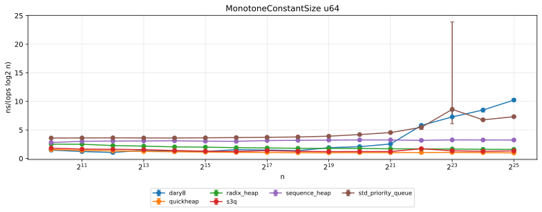

# Quickheap C++

Pure C++ port of [quickheap](https://github.com/RagnarGrootKoerkamp/quickheap).
Descending pivots divide reusable buckets. Pop partitions oversized minimum
buckets, then sorts at most 16 entries. The algorithm mirrors upstream Rust
`SimdQuickHeap` step for step. x86-64 builds use AVX2 intrinsics and require an
AVX2 CPU. `-o quickheap/*:scalar=True` builds portable scalar kernels.

## Build and test

Requires Conan 2, CMake 4, Ninja, and a C++20 compiler. Public C++ headers
support C++17 consumers. Conan profiles select build standard. Conan supplies
Catch2 3.16.0 for library tests.

If no Conan profile is configured, detect the installed compiler first.

```sh
conan profile detect
```

Build with the detected profile or substitute your own host and build profiles.

```sh
conan build . -pr:h default -pr:b default -s:h compiler.cppstd=20 --build=missing
conan create . -pr:h default -pr:b default -s:h compiler.cppstd=20 --build=missing
```

Tests run by default. Add `-c tools.build:skip_test=True` to skip execution.

Conan profiles select compilers, linkers, compiler caches, and sanitizer flags.
Use separate host and build profiles when cross-compiling. Set `CONAN_HOME`
before invoking Conan to select another cache.

## Use C++

```cpp
#include <quickheap.hpp>

quickheap::Heap<std::uint64_t> queue;
queue.push(7);
queue.push(1);
auto minimum = queue.try_pop();  // 1

quickheap::KvSimdQuickHeap<std::int64_t> events;
events.push(-4, 42);
auto event = events.try_pop();   // pair(-4, 42)
```

Both heaps support `int32_t`, `uint32_t`, `int64_t`, and `uint64_t`.
Duplicate keys are valid. Equal-key payload order is unspecified. Heaps are
move-only. After moving, destroy or assign the source before using it.
`pop()` requires a nonempty heap. `try_pop()` returns `std::nullopt` when empty.

## Use C

```c
#include <quickheap.h>

QuickHeapU64 *queue = quickheap_u64_new();
quickheap_u64_push(queue, 7);
uint64_t value;
bool found = quickheap_u64_pop(queue, &value);
quickheap_u64_free(queue);
```

Existing `quickheap_<type>_*` declarations match the Rust headers. Empty pop
returns false and leaves output untouched. Null arguments and allocation
failures abort. Capacity counts allocated element slots across buckets,
including retained empty buckets. Key/value capacity sums both columns.

## Link with CMake

```cmake
find_package(quickheap REQUIRED CONFIG)
target_link_libraries(app PRIVATE quickheap::quickheap)
```

Conan's CMakeDeps generator provides `quickheap::quickheap` and propagates
dependencies for static and shared packages. Consumers require only Quickheap.
Public headers do not expose SIMD types. Installed headers and libraries support
Conan editable packages.

`quickheap/detail/` holds the header-only heap that the library wraps. The
benchmarks include it directly so heap calls inline, as the Rust harness does.
These headers require C++20, select AVX2 kernels only when compiled with AVX2
enabled, and are not a stable API.

## Performance



Each heap holds `n` `u64` keys and repeats `10n` times: pop the minimum, then
push it back plus a random offset (`MonotoneConstantSize`). The plot divides
time per pair by $\log_2 n$, so a comparison heap with constant per-level cost
draws a flat line. `SimdQuickHeap` is the fastest heap from $2^{15}$ upward
and stays within 1.6x of its $2^{10}$ time at $2^{25}$. Points mark the
median of 3 trials and bars the range. The tall `std_priority_queue` bar at
$2^{23}$ comes from one trial at 2.8x the median on the shared host.

The table gives nanoseconds per push and pop pair, the median of 3 trials.
LLC misses counts `PERF_COUNT_HW_CACHE_MISSES` per pair at $2^{25}$. A `*`
marks a single trial: each of those runs takes 10 to 20 minutes.

| Heap | Algorithm | $2^{10}$ | $2^{15}$ | $2^{20}$ | $2^{25}$ | LLC misses |
| --- | --- | ---: | ---: | ---: | ---: | ---: |
| `std_priority_queue` | `std::priority_queue` binary heap | 35.9 | 54.3 | 83.8 | 183.0 | 27.745 |
| `custom_binary_heap` | Binary heap, swap sift | 18.2 | 28.2 | 86.4 | 749.0 | 16.867 |
| `dary4` | 4-ary heap, hole sift | 10.4 | 20.8 | 39.1 | 330.9 | 8.347 |
| `dary8` | 8-ary heap, hole sift | 14.7 | 18.6 | 41.6 | 255.6 | 7.632 |
| `dary16` | 16-ary heap, hole sift | 18.2 | 26.1 | 44.6 | 282.2 | 9.524 |
| `custom_dary4` | 4-ary heap, swap sift | 12.9 | 23.5 | 60.6 | 365.9 | 11.343 |
| `custom_dary8` | 8-ary heap, swap sift | 17.2 | 22.7 | 57.5 | 276.4 | 10.313 |
| `boost_dary4` | Boost 4-ary heap | 16.0 | 28.0 | 54.8 | 362.6 | 13.476 |
| `weak_heap` | Weak heap | 18.6 | 27.9 | 72.4 | 442.3 | 14.117 |
| `radix_heap` | Radix heap, native | 25.1 | 29.9 | 35.2 | 39.9 | 0.915 |
| `external_radix_heap` | Radix heap, `iwiwi/radix-heap` | 32.1 | 36.5 | 40.5 | 43.0 | 0.756 |
| `sequence_heap` | Sanders' sequence heap | 28.0 | 45.5 | 64.9 | 80.9 | 0.348 |
| `s3q` | S3Q sample-sort queue | 18.2 | 19.2 | 24.4 | 33.3 | 1.661 |
| `original_quickheap` | Original quickheap, Paredes & Navarro | 39.9 | 48.5 | 62.0 | 72.5 | 1.082 |
| `scalar_quickheap` | Scalar quickheap | 35.6 | 49.1 | 64.2 | 80.9 | 1.857 |
| `blocked_quickheap` | Quickheap, linked 128-slot blocks | 65.1 | 85.0 | 108.8 | 154.8 | 6.474 |
| `quickheap` | SimdQuickHeap, AVX2 | 15.6 | 16.9 | 20.6 | 24.6 | 1.101 |
| `boost_fibonacci` | Boost Fibonacci heap | 70.0 | 122.9 | 598.7 | 1592.7\* | 53.059\* |
| `boost_pairing` | Boost pairing heap | 131.2 | 243.4 | 1218.2 | 3022.8\* | 67.131\* |
| `boost_binomial` | Boost binomial heap | 255.6 | 385.3 | 1236.6 | 2651.8\* | 48.141\* |
| `boost_skew` | Boost skew heap | 57.3 | 125.0 | 1187.4 | 3163.7\* | 54.068\* |

Notes on the table:

- Radix heaps require monotone keys. This workload satisfies that; general
  workloads do not.
- Small d-ary heaps win at $2^{10}$, where the whole 8 KiB heap fits in L1.
- At $2^{25}$ `std_priority_queue` beats every d-ary heap despite 3.6x more
  LLC misses than `dary8`. Its 27.7 misses per pair cannot run one after
  another in 183 ns, so they overlap. The likely cause is that libstdc++ sifts
  with predictable branches, which lets the CPU issue the next level's loads
  early. This explanation is inferred from the counters, not tested.
- The Rust README reports an "L2 misses" column measured on AMD. Its counter
  differs, so the miss columns are not comparable.

Data types at $n = 2^{20}$, median of 5 trials:

| Data type | Heap | ns/pair |
| --- | --- | ---: |
| `u32` | `quickheap` | 16.5 |
| `u64` | `quickheap` | 20.8 |
| `(u32,u32)` | `kv_quickheap` | 28.4 |
| `(u64,u64)` | `kv_quickheap` | 36.6 |

Measured 2026-10-27 on an Intel Core Ultra 9 285K, pinned to P-core 5, with
Clang 24 `-O3 -mavx2 -mbmi -mpopcnt`. Other users' jobs shared the host.
[benchmark/ALGORITHMS.md](benchmark/ALGORITHMS.md) reproduces the plot and
tables. [docs/cpp-vs-rust.md](docs/cpp-vs-rust.md) compares this port with
the Rust crate on the same algorithm.

## Run benchmarks

Local performance checks use Catch2 benchmarks in `test/`. A normal test
build creates `quickheap_benchmark`. Run benchmarks explicitly.

```sh
build/Release/test/quickheap_benchmark '[!benchmark]'
build/Release/test/quickheap_benchmark '[!benchmark]' --section 1024 \
    --benchmark-samples 1 --benchmark-warmup-time 0 --benchmark-no-analysis
```

Eight workloads cover signed and unsigned 32-bit and 64-bit keys with
key-only and key/value Quickheap. Catch2 controls calibration, warmup, and
samples. Input generation, setup, output validation, and destruction stay
outside timing. Each calibrated iteration uses fresh queue and output state.
Benchmark tests use hidden `[!benchmark]` tags and run separately from CTest
correctness checks. `BUILD_TESTING=OFF` excludes local test targets.

Algorithm and configuration comparisons use the separate Conan application
under `benchmark/`. Build Quickheap with `conan create .`, then follow
[comparison build and run instructions](benchmark/README.md). The main
package builds and tests without the `benchmark/` directory.

## Verify the port

Conan build and package creation run correctness checks by default. Tests cover
all integer types, both heap variants, C callers, and external C/C++ consumers.
Differential checks compare deterministic traces with Rust and Python's
min-heap oracle.

```sh
python3 scripts/differential.py build/Release/test/quickheap_trace
```

Rust is needed only for this comparison. See
[verification instructions](docs/verification.md) for package configurations
and platform coverage.
